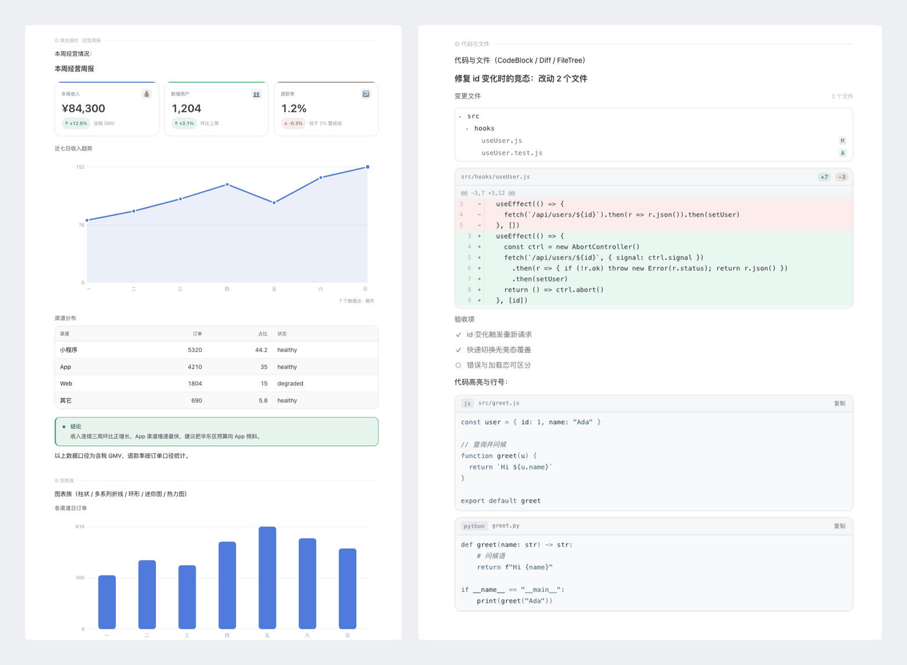

# Intelligence UI for DeepSeek Harness

**Chat replies that render as interfaces, not walls of Markdown.**

A plugin for DeepSeek Harness (DSH) that upgrades the assistant-message renderer:
model-authored [OpenUI Lang](https://github.com/thesysdev/openui) fences render as cards, tables,
charts and diagrams in place, while structured Markdown is automatically compiled into the same
visual language. Plain text stays plain text.

[](https://github.com/MarkYangKp/dsh-intelligence-ui/actions/workflows/ci.yml)
[](LICENSE)
[](package.json)
[](docs/COMPONENTS.md)



[中文说明](README.zh-CN.md) · [Docs index](docs/README.md) · [Component reference](docs/COMPONENTS.md) · [Design system](docs/design.md) · [Architecture](docs/ARCHITECTURE.md) · [Gallery (GitHub Pages)](https://MarkYangKp.github.io/dsh-intelligence-ui/gallery.html) · [Light](docs/gallery.png) / [dark](docs/gallery-dark.png) / [mobile](docs/gallery-mobile.png)

**Status:** v1.1.0 · 44 components · MIT · light/dark themes · 390/920px · macOS tested locally, Linux covered by CI.

> The gallery page is served by GitHub Pages once enabled in the repository settings (see
> [RELEASING.md](RELEASING.md)); the PNG links work immediately.

---

## Why not plain Markdown?

Markdown is excellent for prose but poor at structure: KPI comparisons turn into walls of text,
tables lose hierarchy on mobile, and trends are invisible. Intelligence UI keeps Markdown for the
parts that are prose and upgrades the rest:

- **Structure where it matters** — metrics, comparisons, timelines, steps, trees, charts and code
  changes render in their natural form instead of ASCII tables.
- **Fast to read** — compact previews, aligned numbers, semantic status colours, one accent per
  screen.
- **Safe by construction** — a bad program never breaks the message; invalid input degrades to a
  local notice or plain text.
- **No new app, no build** — it ships as one directory bundle inside the chat you already use.

## What it does

An assistant reply can mix prose and interface blocks. The plugin intercepts the
`assistant-step` renderer (priority −20) and runs a three-mode pipeline:

| Reply shape       | Trigger                                                   | Rendering                                                           |
| ----------------- | --------------------------------------------------------- | ------------------------------------------------------------------- |
| **Native fence**  | a ` ```openui ` program in the reply                      | parse → evaluate → render components in place (highest fidelity)    |
| **Auto-compiled** | no fence, but Markdown tables / KPI lists / ordered steps | the client compiler turns them into cards, charts and search tables |
| **Plain text**    | everything else                                           | the host Markdown renderer, unchanged                               |

Text outside a fence stays Markdown, so one reply can be: explanation → chart → caveat.
Rendering is insertion-based: nothing is merged, rewritten or stripped.

```openui
root = Stack([kpis, chart, note], "column", 16)
kpis = Grid([a, b], 2, 12, 150)
a = StatCard("Revenue", "¥84,300", "+12.6%", "up", null, "gross, tax included", "brand")
b = StatCard("Refund rate", "1.2%", "-0.3%", "down", null, "below the 2% guardrail", "warning")
chart = Chart("Last 7 days", "area", [{name: "Revenue", values: [82, 94, 110, 129, 105, 138, 152]}], [], ["Mon", "Tue", "Wed", "Thu", "Fri", "Sat", "Sun"], 220)
note = Callout("Takeaway", "Revenue grew three weeks in a row; shift budget toward the fastest channel.", "success")
```

## Features

- **44 components** — primitives, layout, containers, text, data (metrics/tables/timeline/steps),
  charts (bar/line/area, donut, sparkline, heatmap), a schematic world map, code/diff/file panels,
  tree and graph views with playback, and interactive controls.
- **Theme-native design system** — every colour, radius and type step is a host theme token;
  light/dark follow automatically, with zero hard-coded colours (enforced by tests). Data uses the
  host business-blue accent; status text keeps accessible contrast in both themes.
- **Reply compiler** — a zero-dependency, deterministic Markdown → OpenUI compiler; pathological
  input safely falls back to plain Markdown.
- **Built for real model output** — positional/named/colon arguments, bare child elements,
  Python/JS literals, enum synonyms and programs written as plain code blocks are recovered;
  invalid props degrade to a local notice instead of breaking the message.
- **Streaming-safe** — unfinished fences render while the model is still writing; the final frame
  keeps the same component instances.
- **Compact by default** — charts, maps, tables and long code render compact with an in-place
  expand control.
- **Prompt architecture** — the host injects an adaptive presentation policy plus a capability
  reference, so the model knows _when_ and _how_ to use the UI.

## Requirements

|              |                                                                                                                                                                                                                                                                       |
| ------------ | --------------------------------------------------------------------------------------------------------------------------------------------------------------------------------------------------------------------------------------------------------------------- |
| **Host**     | [DeepSeek Harness (DSH)](https://www.deepseek.com/harness/) desktop app ([source](https://github.com/deepseek-ai/deepseek-harness)), with a build that exposes **plugin bundles** (`engines.dsh >= 0.2.1-rc.0`). This repository is the plugin, not a standalone app. |
| **Node.js**  | `>= 20` — only needed to build and run tests (the repository ships a prebuilt `lib/client.js`).                                                                                                                                                                       |
| **pnpm**     | `12` — pinned through `packageManager` (Corepack picks it up automatically).                                                                                                                                                                                          |
| **Chrome**   | Any recent Chrome/Chromium for the browser-based tests (`CHROME=/path/to/chrome` if auto-detection fails).                                                                                                                                                            |
| **Platform** | macOS (14+) and Linux tested; Windows is expected to work but untested for the Chrome-based suites.                                                                                                                                                                   |

> `engines.dsh` refers to the host's plugin-bundle API version; check the DSH build notes for the
> exact minimum.

The plugin renders against the host's `--dsw-*` theme tokens and platform modules
(`@deepseek-ai/dsh-client-*`). Those are supplied by the host; nothing needs to be installed
globally.

## Quickstart

Five minutes from zero to a rendered reply:

1. **Install DeepSeek Harness** — download the desktop app from
   [deepseek.com/harness](https://www.deepseek.com/harness/). AI features need a configured model in
   DSH.
2. **Get the plugin** — `git clone https://github.com/MarkYangKp/dsh-intelligence-ui.git`
   (no build step: `lib/client.js` is committed).
3. **Install the directory as a bundle** — open DSH's plugin manager and install this repository as
   a plugin bundle (choose the install-from-directory / bundle option and point it at the repository
   root). Menu labels vary slightly between DSH versions.
4. **Restart DSH** and open a chat. The browser console should show
   `[dsh-intelligence-ui/1.1.0]`.
5. **Paste the example below** into a message (as-is, no extra prompt needed) and send it.

If step 3 is unavailable in your DSH build, that build does not expose plugin bundles and cannot
load this plugin; upgrade DSH or use a build with bundle support.

### Build from source (optional)

```bash
pnpm install
pnpm build          # writes lib/client.js
# then install this directory as a bundle, as in step 3
```

To update: `git pull && pnpm install && pnpm build`, then reload the chat page (⌘R / Ctrl-R).
To remove: uninstall the bundle in the plugin manager and restart DSH.

> Maintainers iterating on the host machine can use
> `node scripts/deploy.mjs --to <plugin-directory>` to rebuild, back up the target and rsync the
> repository into the directory the host loads.

## Usage

Write normal Markdown; insert a fence where the interface belongs:

````markdown
Ops review:

```openui
root = Stack([hd, tl, ok], "column", 16)
hd = Heading("Incident review", 2)
tl = Timeline([{"title": "14:02 alert", "description": "error rate > 15%", "time": "14:02", "variant": "error"}, {"title": "14:26 rollback complete", "description": "error rate back to 0.4%", "time": "14:26", "variant": "success"}])
ok = Callout("Next", "Add a connection-pool limit to the index job.", "info")
```
````

No fence? Structured Markdown is upgraded automatically. Both paths share one
`parse → evaluate → render` pipeline.

- Component signatures and program syntax: [docs/COMPONENTS.md](docs/COMPONENTS.md).
- Ten runnable examples (with an overview): [`examples/`](examples/README.md).
- Emergency switch to disable Markdown auto-compilation (browser console):
  `localStorage['dsh-intelligence-ui:disable-auto']='1'`.

## Components

44 components across ten groups; full signatures live in [docs/COMPONENTS.md](docs/COMPONENTS.md).

| Group        | Components                                                                                    |
| ------------ | --------------------------------------------------------------------------------------------- |
| Primitives   | `Box` `Row` `Col` `Text` `Icon` `Image` `Link`                                                |
| Layout       | `Stack` `Grid` `Divider` `Spacer`                                                             |
| Containers   | `Card` `CardHeader` `Section` `Callout` `Quote`                                               |
| Text         | `Heading` `TextContent` `BulletList` `KeyValue` `CodeBlock` `Badge` `BadgeGroup`              |
| Data         | `StatCard` `Table` `SearchTable` `ProgressBar` `ComparisonBar` `Timeline` `Steps` `Checklist` |
| Charts       | `Chart` `PieChart` `Sparkline` `Heatmap`                                                      |
| Geography    | `Map`                                                                                         |
| Code & files | `Diff` `FileTree`                                                                             |
| Process      | `TreeView` `Diagram`                                                                          |
| Interactive  | `Button` `Tabs` `Accordion` `SegmentedControl`                                                |

## Design system

The visual language is "Precision Editorial": host ink typography, a single business-blue accent
for data, hairline structure and layered surfaces. All tokens live in
[`src/ui/theme.js`](src/ui/theme.js); rationale, type scale and per-component guidance are in
[docs/design.md](docs/design.md).

A headless-Chrome design gate measures computed styles (no gradients, no static shadows, no
uppercase labels, no horizontal overflow, bounded type scale, WCAG AA text contrast — 4.5:1 for
normal text, 3:1 for large text, bounded accent hues) across light/dark × 920/390.

## Accessibility

- Design gates enforce WCAG AA contrast in both themes, keyboard focus for interactive controls,
  `prefers-reduced-motion`, and no horizontal overflow at 390px.
- Components use semantic HTML (headings, tables, lists, buttons) and `aria-*` labels where needed;
  charts carry text labels for series, axes and values.
- Known gaps: SVG charts are not yet exposed as an accessible data table, and the schematic map is
  not keyboard-navigable. Contributions welcome.

## How it works

````
assistant-step text block
  ├─ ```openui fence ─► parse → evaluate → render components (text outside stays Markdown)
  ├─ no fence, settled ─► Markdown compiler → OpenUI program → render
  └─ otherwise ─► host Markdown renderer
````

The repository contains both halves of the plugin: a host half that injects prompt modules
(`index.js`) and a browser half that registers the renderer (`src/` → `lib/client.js`). Component
implementations are split into focused modules under `src/ui/`; the tolerant binding layer and
render pipeline live in `src/openui-runtime.jsx`. Isolation boundaries, resource budgets, streaming
identity and clipboard/timer cleanup are described in [docs/ARCHITECTURE.md](docs/ARCHITECTURE.md).

## Development

```bash
pnpm install
pnpm build            # → lib/client.js (committed; CI checks it is up to date)
pnpm test             # build + unit/browser suites (310 checks; browser suites skip without Chrome)
pnpm test:unit        # the same suites without browser tests (no Chrome needed)
pnpm test:design      # computed-style design gates in headless Chrome (36 checks)
pnpm test:interact    # chart/map interaction regressions in headless Chrome (10 checks)
pnpm test:docs        # relative Markdown links must exist and be tracked
pnpm format           # Prettier
pnpm format:check     # verify formatting (CI gate)
pnpm shot             # regenerate docs/gallery{,-dark,-mobile}.png + gallery.html
pnpm preview -- --name me --only "图表" --theme both
```

Test suites cover a synthetic 56-program corpus, 63 adversarial inputs, the Markdown compiler,
theme-token fidelity, prompt modules, bundle budget/schema fingerprint, chart SSR, and real-browser
lifecycle/heap checks. See [CONTRIBUTING.md](CONTRIBUTING.md) for prerequisites and PR
expectations.

The gallery and design gate prefer a local snapshot of the host theme. Generate one with
`node scripts/extract-theme.mjs` (optional; it falls back to an original approximation in
`test/fixtures/theme-fallback.css`).

Generated artefacts in this repository: `lib/client.js` (the shipped bundle) and
`docs/gallery*` / `docs/hero.png` (rendered by `pnpm shot`). Do not edit them by hand; CI verifies
the bundle is in sync with `src/`.

## Privacy & telemetry

The plugin itself has **no analytics, no telemetry and makes no network requests**. Installing the
development dependencies does not send telemetry either: the upstream `@openuidev/lang-core`
install hook is explicitly denied in this repository's `pnpm-workspace.yaml` (see
[SECURITY.md](SECURITY.md)). Remote images
that a user or model references through the `Image` component are loaded by the host, like any other
chat image. The bundled upstream `@openuidev/lang-core` telemetry path is disabled unless the host
explicitly sets `OPENUI_RUNTIME_TELEMETRY_ENABLED`; the browser runtime never enables it (the
inert upstream code is documented in [SECURITY.md](SECURITY.md)). Clipboard access happens only
through user-initiated copy buttons.

## Language support

The component library and host API are locale-neutral. The injected prompt modules, example
programs and gallery content are currently written in **Chinese**, the primary language of the
first release; an English prompt set is on the roadmap. UI chrome rendered by the plugin itself is
minimal and language-neutral; number and date formatting comes from the content.

## Limitations

- The map is schematic: an equirectangular projection with a simplified world outline — suitable
  for distributions and routes, not for navigation.
- On 390px screens, tree/diagram figures scale to fit (labels get small) instead of scrolling.
- Expand state is per message, not persisted across replies.
- Auto-compilation only recognises clear structures; prose numbers are not turned into charts.
- The tolerance layer fixes syntax, not semantics: swapped values cannot be detected.
- Rendering depends on host internals (renderer slot, theme tokens, platform module table); a host
  upgrade may require plugin changes.

## Documentation

| Doc                                                                           | Contents                                                                 |
| ----------------------------------------------------------------------------- | ------------------------------------------------------------------------ |
| [docs/COMPONENTS.md](docs/COMPONENTS.md)                                      | All 44 components, signatures, program syntax rules                      |
| [docs/ARCHITECTURE.md](docs/ARCHITECTURE.md)                                  | Reply pipeline, module map, robustness, prompt architecture, test matrix |
| [docs/design.md](docs/design.md)                                              | Design-system v3 tokens, type scale, per-component visual guidance       |
| [docs/README.md](docs/README.md)                                              | Documentation index                                                      |
| [Gallery page](https://MarkYangKp.github.io/dsh-intelligence-ui/gallery.html) | Full rendered gallery (generated; served by GitHub Pages)                |

## Contributing

Issues and pull requests are welcome — see [CONTRIBUTING.md](CONTRIBUTING.md),
[CODE_OF_CONDUCT.md](CODE_OF_CONDUCT.md) and [SECURITY.md](SECURITY.md). Visual changes should
include light/dark and 920/390 screenshots. Release steps live in [RELEASING.md](RELEASING.md);
changes are tracked in [CHANGELOG.md](CHANGELOG.md).

## Acknowledgements

- [OpenUI Lang](https://github.com/thesysdev/openui) by Thesys (`@openuidev/lang-core`, MIT) —
  parser, evaluator and type system for the language.
- Natural Earth (public domain) and [`world-atlas`](https://github.com/topojson/world-atlas) (ISC)
  for the world outline data.
- [DeepSeek Harness](https://github.com/deepseek-ai/deepseek-harness) — the host platform and theme
  system this plugin renders against.
- Design principles borrowed from the "design taste" school of restrained editorial interfaces.

Third-party license texts: [THIRD_PARTY_NOTICES.md](THIRD_PARTY_NOTICES.md).

## License

[MIT](LICENSE) © 2026 MarkYangKp
