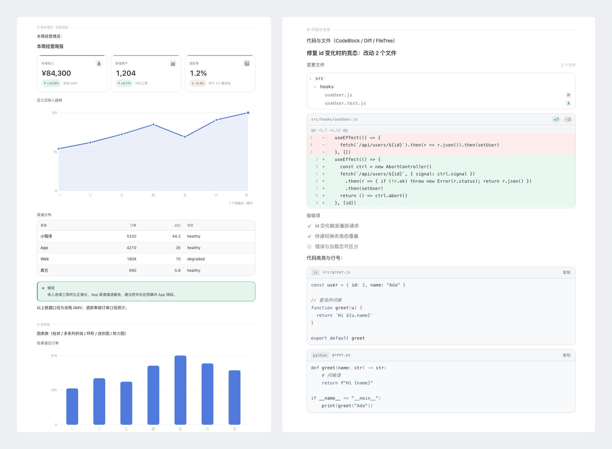

# Intelligence UI for DeepSeek Harness

**把助手回复渲染成界面，而不是一大段 Markdown。**

DeepSeek Harness（DSH）插件：接管助手消息渲染——模型写的
[OpenUI Lang](https://github.com/thesysdev/openui) 围栏直接渲染成卡片、表格、图表与流程图；
没有写围栏时，结构化 Markdown 会被自动编译成同一套视觉语言。纯文字保持原样。

[](https://github.com/MarkYangKp/dsh-intelligence-ui/actions/workflows/ci.yml)
[](LICENSE)
[](package.json)
[](docs/COMPONENTS.md)



[English](README.md) · [文档索引](docs/README.md) · [组件参考](docs/COMPONENTS.md) · [设计系统](docs/design.md) · [架构说明](docs/ARCHITECTURE.md) · [画廊（GitHub Pages）](https://markyangkp.github.io/dsh-intelligence-ui/gallery.html) · [亮色](docs/gallery.png) / [暗色](docs/gallery-dark.png) / [窄屏](docs/gallery-mobile.png)

**状态：** v1.1.1 · 44 个组件 · MIT · 明暗主题 · 390/920px · macOS 本地验证，Linux 由 CI 覆盖。

> 画廊页面需在 GitHub 仓库设置中启用 Pages（步骤见 [RELEASING.md](RELEASING.md)）；PNG 链接可立即查看。

---

## 为什么不只用 Markdown？

Markdown 适合散文，不适合结构：KPI 对比会变成文字墙，表格在窄屏上丢掉层次，趋势完全看不见。
Intelligence UI 把该用文字的部分留给 Markdown，其余部分升级成界面：

- **结构用在刀刃上**：指标、对比、时间线、步骤、树、图表、代码改动按它们本来的形态呈现，而不是
  ASCII 表格。
- **读得更快**：紧凑预览、数字右对齐、语义状态色、一屏只保留一个点缀色。
- **天生安全**：坏掉的程序不会打断整条消息；非法输入只降级为局部提示或纯文字。
- **不换应用、不用构建**：作为单个目录 bundle 装进你正在用的聊天窗口。

## 它做什么

一条回复可以混排文字与界面块。插件抢注 `assistant-step` 渲染座位（priority −20），
按三种形态处理：

| 回复形态     | 触发条件                                           | 渲染方式                                 |
| ------------ | -------------------------------------------------- | ---------------------------------------- |
| **原生围栏** | 回复里有 ` ```openui ` 程序                        | 解析 → 求值 → 原地渲染组件（保真度最高） |
| **自动编译** | 没有围栏，但含 Markdown 表格 / KPI 列表 / 有序步骤 | 客户端编译器升级成卡片、图表、搜索表格   |
| **纯文字**   | 其它情况                                           | 官方 Markdown 渲染，原样不动             |

围栏外的文字照常按 Markdown 渲染，所以一条回复可以是「说明 → 图表 → 补充说明」。
渲染是插入式的：不合并、不改写、不吞内容。

```openui
root = Stack([kpis, chart, note], "column", 16)
kpis = Grid([a, b], 2, 12, 150)
a = StatCard("本周收入", "¥84,300", "+12.6%", "up", null, "含税 GMV", "brand")
b = StatCard("退款率", "1.2%", "-0.3%", "down", null, "低于 2% 警戒线", "warning")
chart = Chart("近七日", "area", [{name: "收入", values: [82, 94, 110, 129, 105, 138, 152]}], [], ["一", "二", "三", "四", "五", "六", "日"], 220)
note = Callout("结论", "收入连续三周环比正增长，建议把预算向增速最快的渠道倾斜。", "success")
```

## 特性

- **44 个组件**：原语、布局、容器、文本、数据（指标/表格/时间线/步骤）、图表（柱线面积、
  环形、迷你图、热力）、示意级世界地图、代码/差异/文件树、可播放的树与图，以及交互控件。
- **主题原生设计系统**：颜色、圆角、字号全部来自宿主主题 token，明暗主题自动跟随，零硬编码颜色
  （有测试把关）；数据使用宿主业务蓝点缀色，状态文字在明暗主题下都保持可读对比度。
- **回复编译器**：零依赖、确定性的 Markdown → OpenUI 编译器；病态输入安全退回纯文字。
- **为真实模型输出而建**：位置/命名/冒号参数、裸子元素、Python/JS 字面量、枚举同义词、
  写在普通代码块里的程序都能救回；字段不合法只降级为局部提示，不打断整条消息。
- **流式安全**：未闭合围栏边生成边渲染；定稿不会重挂载控件实例。
- **默认紧凑**：图表、地图、表格、长代码默认收紧，点「展开」原地放大。
- **提示词架构**：宿主每轮注入「呈现策略 + 组件能力」两个模块，让模型知道*什么时候*、*怎么*用界面。

## 环境要求

|             |                                                                                                                                                                                                                        |
| ----------- | ---------------------------------------------------------------------------------------------------------------------------------------------------------------------------------------------------------------------- |
| **宿主**    | [DeepSeek Harness（DSH）](https://www.deepseek.com/harness/) 桌面版（[源码](https://github.com/deepseek-ai/deepseek-harness)），且构建支持**插件 bundle**（`engines.dsh >= 0.2.1-rc.0`）。本仓库是插件，不是独立应用。 |
| **Node.js** | `>= 20`，仅构建与测试需要（仓库已带构建产物 `lib/client.js`，安装无需构建）。                                                                                                                                          |
| **pnpm**    | `12`，通过 `packageManager` 固定（Corepack 会自动使用）。                                                                                                                                                              |
| **Chrome**  | 浏览器相关测试需要 Chrome/Chromium（无法自动发现时设置 `CHROME=/path/to/chrome`）。                                                                                                                                    |
| **平台**    | macOS（14+）与 Linux 已验证；Windows 预期可用，但 Chrome 相关测试未验证。                                                                                                                                              |

> `engines.dsh` 指宿主插件 bundle API 的版本，具体最低版本以 DSH 构建说明为准。

插件渲染依赖宿主提供的 `--dsw-*` 主题 token 与平台模块（`@deepseek-ai/dsh-client-*`），
无需全局安装任何东西。

## 快速开始

五分钟从零到渲染出界面：

1. **安装 DeepSeek Harness** —— 从 [deepseek.com/harness](https://www.deepseek.com/harness/) 下载桌面
   应用，并在 DSH 中配置好可用模型。
2. **获取插件** —— `git clone https://github.com/MarkYangKp/dsh-intelligence-ui.git`
   （无需构建：`lib/client.js` 已进仓）。
3. **把目录装成 bundle** —— 打开 DSH 插件管理器，选择「从本地目录安装 / install bundle」，指向仓库
   根目录。不同 DSH 版本菜单措辞略有差异。
4. **重启 DSH** 并打开聊天窗口；浏览器控制台应出现 `[dsh-intelligence-ui/1.1.1]`。
5. **把下面的示例原样粘贴**到输入框发送，即可看到界面。

如果第 3 步在你的 DSH 构建里不存在，说明该构建未开放插件 bundle 能力，无法加载本插件；请升级
DSH 或使用支持 bundle 的构建。

### 从源码构建（可选）

```bash
pnpm install
pnpm build          # 生成 lib/client.js
# 然后同快速开始第 3 步安装本目录为 bundle
```

更新：`git pull && pnpm install && pnpm build`，然后刷新聊天页面（⌘R / Ctrl-R）。
卸载：在插件管理器里卸载 bundle，重启 DSH。

> 维护者在宿主机器上迭代时可用
> `node scripts/deploy.mjs --to <插件目录>` 一键构建 + 备份 + rsync 到宿主加载的目录。

## 使用

正常写 Markdown，在需要界面的位置插入围栏：

````markdown
故障复盘：

```openui
root = Stack([hd, tl, ok], "column", 16)
hd = Heading("故障复盘", 2)
tl = Timeline([{"title": "14:02 告警", "description": "错误率超过 15%", "time": "14:02", "variant": "error"}, {"title": "14:26 回滚完成", "description": "错误率回落至 0.4%", "time": "14:26", "variant": "success"}])
ok = Callout("下一步", "给索引任务补上连接池上限。", "info")
```
````

不写围栏也可以——结构化 Markdown 会被自动升级。两条路径共用同一套
`parse → evaluate → render` 管线。

- 组件签名与程序语法：[docs/COMPONENTS.md](docs/COMPONENTS.md)。
- 10 个可直接运行的示例（含说明）：[`examples/README.md`](examples/README.md)。
- 临时关闭自动编译（浏览器控制台）：
  `localStorage['dsh-intelligence-ui:disable-auto']='1'`。

## 组件

十类共 44 个组件，完整签名见 [docs/COMPONENTS.md](docs/COMPONENTS.md)。

| 分类       | 组件                                                                                          |
| ---------- | --------------------------------------------------------------------------------------------- |
| 原语       | `Box` `Row` `Col` `Text` `Icon` `Image` `Link`                                                |
| 布局       | `Stack` `Grid` `Divider` `Spacer`                                                             |
| 容器       | `Card` `CardHeader` `Section` `Callout` `Quote`                                               |
| 文本       | `Heading` `TextContent` `BulletList` `KeyValue` `CodeBlock` `Badge` `BadgeGroup`              |
| 数据       | `StatCard` `Table` `SearchTable` `ProgressBar` `ComparisonBar` `Timeline` `Steps` `Checklist` |
| 图表       | `Chart` `PieChart` `Sparkline` `Heatmap`                                                      |
| 地理       | `Map`                                                                                         |
| 代码与文件 | `Diff` `FileTree`                                                                             |
| 过程       | `TreeView` `Diagram`                                                                          |
| 交互       | `Button` `Tabs` `Accordion` `SegmentedControl`                                                |

## 设计系统

「Precision Editorial」：宿主墨色排版 + 单一业务蓝点缀 + 发丝线结构 + 分层表面。
token 全部在 [`src/ui/theme.js`](src/ui/theme.js)，动机、字号阶梯与逐组件规范见
[docs/design.md](docs/design.md)。

无头 Chrome 设计门禁基于计算样式测量：无渐变、静止元素无阴影、无大写标签、无横向溢出、
字号档位受控、文字对比度满足 WCAG AA（正文 4.5:1、大字 3:1）、强调色色相受控；覆盖明暗 ×
920/390。

## 无障碍

- 设计门禁在明暗主题下强制 WCAG AA 对比度、交互控件的键盘焦点、`prefers-reduced-motion`，
  并检查 390px 下无横向溢出。
- 组件使用语义化 HTML（标题、表格、列表、按钮），必要时补 `aria-*`；图表带有系列、坐标轴与
  数值的文字标签。
- 已知缺口：SVG 图表暂未提供可访问的数据表视图；示意地图不支持键盘导航。欢迎贡献。

## 工作原理

````
assistant-step 文本块
  ├─ ```openui 围栏 ─► 解析 → 求值 → 渲染组件（围栏外文字仍按 Markdown）
  ├─ 无围栏且定稿 ─► Markdown 编译器 → OpenUI 程序 → 渲染
  └─ 其它 ─► 官方 Markdown 渲染
````

仓库包含插件的两半：宿主半边注入提示模块（`index.js`），浏览器半边注册渲染器
（`src/` → `lib/client.js`）。组件实现拆分在 `src/ui/` 下，容错绑定层与渲染管线在
`src/openui-runtime.jsx`；隔离边界、资源预算、流式身份保持、复制/定时器清理见
[docs/ARCHITECTURE.md](docs/ARCHITECTURE.md)。

## 开发

```bash
pnpm install
pnpm build            # → lib/client.js（已进仓，CI 会检查是否与源码同步）
pnpm test             # 构建 + 单元/浏览器套件（310 项）
pnpm test:unit        # 不含浏览器测试的同一套件（无需 Chrome）
pnpm test:design      # 无头 Chrome 设计门禁（36 项）
pnpm test:interact    # 无头 Chrome 交互回归（10 项）
pnpm test:docs        # 检查 Markdown 相对链接是否存在且被 Git 跟踪
pnpm format           # Prettier 格式化
pnpm format:check     # 校验格式（CI 门禁）
pnpm shot             # 重新生成 docs/gallery{,-dark,-mobile}.png + gallery.html
pnpm preview -- --name me --only "图表" --theme both
```

测试覆盖：56 段合成回归语料、63 项对抗输入、Markdown 编译器、主题 token 保真、提示词模块、
bundle 体积/schema 指纹、图表 SSR、真实浏览器生命周期与堆检查。开发环境与 PR 约定见
[CONTRIBUTING.md](CONTRIBUTING.md)。

画廊与设计门禁优先使用本地宿主主题快照（`node scripts/extract-theme.mjs` 可选生成）；
没有时使用自写近似主题 `test/fixtures/theme-fallback.css`。

仓库里的生成物：`lib/client.js`（随仓库分发的客户端 bundle）与 `docs/gallery*` /
`docs/hero.png`（由 `pnpm shot` 渲染）。不要手改这些文件；CI 会校验 bundle 与 `src/` 同步。

## 隐私与遥测

插件本身**没有任何分析、遥测，也不发网络请求**。安装开发依赖同样不发送遥测：上游
`@openuidev/lang-core` 的安装钩子已在本仓库 `pnpm-workspace.yaml` 中显式拒绝（见
[SECURITY.md](SECURITY.md)）。用户或模型通过 `Image` 组件引用的远程图片
由宿主加载（与普通聊天图片一致）。打包进 bundle 的上游 `@openuidev/lang-core` 遥测仅在宿主显式
设置 `OPENUI_RUNTIME_TELEMETRY_ENABLED` 时启用，浏览器运行时不会启用（不可达的上游代码已在
[SECURITY.md](SECURITY.md) 说明）。剪贴板只在用户点击复制按钮时写入。

## 语言支持

组件库与宿主 API 与语言无关。注入的提示词模块、示例程序与画廊内容目前为**中文**（首个版本的
主要语言）；英文提示词集在路线图中。插件自身渲染的 UI 文案极少且中性；数字与日期格式来自内容。

## 已知限制

- 地图是示意级的（等距圆柱投影 + 简化世界轮廓）：适合分布与路径，不适合导航。
- 390px 宽度下树/图按比例缩放（标签会变小），而不是横向滚动。
- 展开状态按消息独立，不跨回复记忆。
- 自动编译只识别明确结构；散文中的数字不会变成图表。
- 容错层只修语法，不修语义：数据张冠李戴无法发现。
- 渲染依赖宿主内部（渲染座位、主题 token、平台模块表），宿主升级可能需要插件适配。

## 文档

| 文档                                                                                  | 内容                                               |
| ------------------------------------------------------------------------------------- | -------------------------------------------------- |
| [docs/COMPONENTS.md](docs/COMPONENTS.md)                                              | 44 个组件的完整签名与程序语法规则                  |
| [docs/ARCHITECTURE.md](docs/ARCHITECTURE.md)                                          | 渲染管线、模块图、健壮性设计、提示词架构、测试矩阵 |
| [docs/design.md](docs/design.md)                                                      | 设计系统 v3 的 token、字号阶梯与逐组件视觉规范     |
| [docs/README.md](docs/README.md)                                                      | 文档索引                                           |
| [画廊（GitHub Pages）](https://markyangkp.github.io/dsh-intelligence-ui/gallery.html) | 完整渲染画廊（生成物，由 Pages 提供）              |

## 贡献

欢迎 issue 与 PR——见 [CONTRIBUTING.md](CONTRIBUTING.md)、[CODE_OF_CONDUCT.md](CODE_OF_CONDUCT.md)
与 [SECURITY.md](SECURITY.md)。视觉改动请附明暗 + 920/390 截图；发布流程见
[RELEASING.md](RELEASING.md)，变更记录见 [CHANGELOG.md](CHANGELOG.md)。

## 致谢

- [OpenUI Lang](https://github.com/thesysdev/openui)（Thesys，`@openuidev/lang-core`，MIT）：
  语言的解析器、求值器与类型系统。
- Natural Earth（公有领域）与 [`world-atlas`](https://github.com/topojson/world-atlas)（ISC）：
  世界陆地轮廓数据。
- [DeepSeek Harness](https://github.com/deepseek-ai/deepseek-harness)：本插件渲染所依赖的宿主平台
  与主题系统。
- 设计克制原则参考 design-taste 一类的编辑式界面实践。

第三方许可全文：[THIRD_PARTY_NOTICES.md](THIRD_PARTY_NOTICES.md)。

## 许可

[MIT](LICENSE) © 2026 MarkYangKp
